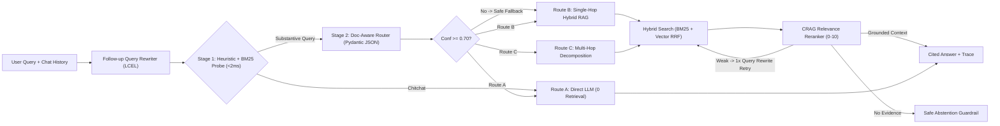

# Adaptive-RAG — Query-Adaptive Hybrid Document Assistant

An end-to-end **Adaptive Retrieval-Augmented Generation (Adaptive-RAG)** web application built with **LangChain (LCEL)**, **FastAPI**, **Google Gemini**, and **Hybrid Retrieval (BM25 + Dense Vector Search via Reciprocal Rank Fusion)**.

Instead of blindly running vector search on every query like Naive RAG, the system classifies query complexity using a **2-Stage Hybrid Router** and dynamically dispatches requests to **Direct LLM (Route A)**, **Single-Hop Corrective RAG (Route B)**, or **Multi-Hop Query Decomposition (Route C)**.

> **Live Demo:** https://adaptive-rag-8f17.onrender.com *(Free Render tier may take ~20–30s on first cold wake-up)*

---

## Key Features

- **2-Stage Hybrid Complexity Router** (`backend/router.py`)
  - **Stage 1 (<2 ms, ₹0):** Fast regex heuristic for greetings/chitchat + sub-2ms Okapi BM25 lexical overlap probe.
  - **Stage 2 (Doc-Aware LCEL Classifier):** `ChatPromptTemplate | llm.with_structured_output(RouteDecision)` inspects the query, indexed document manifest, and BM25 signal to return a validated Pydantic route (`A`, `B`, or `C`), confidence score, and rationale.
  - **Stage 3 (Asymmetric Safety Fallback):** If confidence `< 0.70` or the query references uploaded documents, safely overrides to **Route B** to avoid hallucinations.
- **Hybrid Search + Reciprocal Rank Fusion (RRF)** (`backend/retriever.py`)
  - Combines sparse **Okapi BM25** (`rank-bm25`) for exact keywords/numbers/IDs with dense **Google Gemini Embeddings** (`models/gemini-embedding-001`) in a persisted LangChain **`InMemoryVectorStore`**:
    $$\text{RRF}(d) = \frac{1}{60 + \text{rank}_{\text{BM25}}(d)} + \frac{1}{60 + \text{rank}_{\text{dense}}(d)}$$
- **Corrective RAG (CRAG) Reranker, Auto-Retry & Hallucination Guardrail** (`backend/pipeline.py`)
  - Grades candidate passages (`0–10`) via structured output to filter out noisy chunks before generation.
  - Automatically reformulates the query and retries retrieval once if initial relevance is weak; safely abstains when documents lack evidence.
- **Multi-Turn Conversational Memory**
  - Rewrites follow-up questions (e.g., *"What about for L5 engineers?"*) into self-contained standalone queries before routing and retrieval.
- **Upload-Only Minimal Web UI (Light & Dark Mode)** (`frontend/`)
  - Clean 3-page interface: **Chat (`/`)**, **Benchmark (`/benchmark`)**, and **Architecture (`/architecture`)** with smooth Light/Dark theme transitions and inline expandable routing/citation details.

---

## System Architecture



---

## Benchmark Results

Evaluated via an isolated 9-question multi-complexity benchmark (3 Simple / Route A, 3 Single-Hop / Route B, 3 Multi-Hop / Route C) using `Hybrid (BM25 + Vector RRF)`:

| Method | Keyword Recall Accuracy | Avg Retrieval Steps | Router Accuracy |
|---|---:|---:|---:|
| **No-RAG (Always Route A)** | `50.0%` | `0.00` | Static |
| **Naive RAG (Always Route B)** | `62.0%` | `1.33` | Static |
| **Adaptive RAG (Ours)** | **`94.4%`** (`+32.4%`) | **`1.11`** | **`88.9%`** |

---

## Tech Stack

| Layer | Technologies |
|---|---|
| **Backend API** | FastAPI, Uvicorn, Pydantic, `python-multipart` |
| **Orchestration** | LangChain (`langchain-core`, `langchain-text-splitters`, `langchain-google-genai`, LCEL) |
| **LLM & Embeddings** | Google Gemini (`gemini-3.1-flash-lite`, `models/gemini-embedding-001`) |
| **Retrieval & Parsing** | `BM25Okapi` (`rank-bm25`), LangChain `InMemoryVectorStore`, `pypdf`, `RecursiveCharacterTextSplitter` |
| **Frontend** | HTML5, CSS3 (Light/Dark CSS Variables), Vanilla JavaScript |
| **Deployment** | Render (`render.yaml` Blueprint) |

---

## Project Structure

```text
AdaptiveRAG/
├── backend/
│   ├── config.py          # Gemini LLM & Embedding factories + hyperparameters
│   ├── ingestion.py       # PDF/MD/TXT extraction + RecursiveCharacterTextSplitter
│   ├── retriever.py       # BM25Okapi + InMemoryVectorStore + RRF Hybrid Search
│   ├── router.py          # 2-Stage Hybrid Router with Pydantic structured output
│   ├── pipeline.py        # LCEL chains: Memory, Route A/B/C, CRAG Reranker & Guardrail
│   ├── evaluator.py       # Isolated 9-question benchmark harness
│   └── main.py            # FastAPI REST endpoints + static frontend serving
├── frontend/
│   ├── index.html         # Minimal Chat UI (/)
│   ├── benchmark.html     # Benchmark Dashboard (/benchmark)
│   ├── architecture.html  # Architecture & Routing Guide (/architecture)
│   ├── styles.css         # Light/Dark theme + responsive layout
│   ├── app.js             # Chat, upload, multi-turn history, inline trace details
│   ├── benchmark.js       # Benchmark UI controller
│   └── theme.js           # Light/Dark mode toggle with localStorage persistence
├── storage/
│   └── last_eval.json     # Cached benchmark metrics
├── render.yaml            # Render deployment blueprint
├── requirements.txt
├── run.py
└── .env.example
```

---

## Run Locally

```bash
git clone https://github.com/Vaibhavpandey8/Adaptive-RAG.git
cd Adaptive-RAG
pip install -r requirements.txt
```

Create a `.env` file from `.env.example`:
```env
GEMINI_API_KEY=your_gemini_api_key_here
GEMINI_MODEL=gemini-3.1-flash-lite
EMBEDDING_MODEL=models/gemini-embedding-001
```

Start the server:
```bash
python run.py
```

